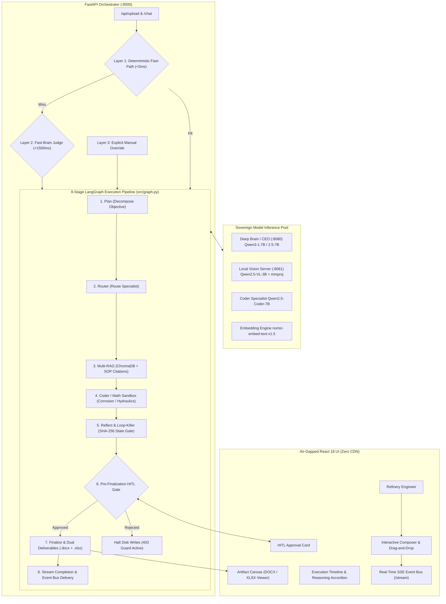

# Swara.ai (Project Kavach) — Sovereign On-Premise Agentic AI Workbench

[](ARCHITECTURE.md)
[](src/graph.py)
[](frontend/)
[-brightgreen?style=flat-square)](tests/)
[](src/test_egress.py)
[](PRD.md)

> **Problem Statement ID:** SIH26117  
> **Organization:** Mangalore Refinery and Petrochemicals Limited (MRPL) / Ministry of Petroleum and Natural Gas (MoPNG)  
> **Core Guarantee:** 100% On-Premise, Air-Gapped Operation — Zero Cloud Egress, Zero External CDN Assets, Deterministic Human-in-the-Loop (HITL) Governance.

---

## 1. Executive Overview

**Swara.ai (Project Kavach)** is a specialized, sovereign agentic AI workbench engineered for high-criticality industrial refinery operations. Designed specifically for MRPL/MoPNG operational requirements, Swara.ai delivers autonomous engineering intelligence across piping and instrumentation diagrams (P&IDs), process safety logs, standard operating procedures (SOPs), and corrosion inspection logs.

Operating within strict physical and logical air-gaps, Swara.ai eliminates third-party cloud vulnerabilities by executing quantized open-weights models (Qwen2.5 / Qwen3 family) entirely on-premise. The system synthesizes refinery data, evaluates mathematical process equations inside an isolated execution sandbox, and generates dual corporate deliverables—official **Word Technical Memorandums (.docx)** and **Engineering Calculation Workbooks (.xlsx)**—guarded by mandatory Human-in-the-Loop (HITL) approval gates.

---

## 2. Key Architecture & Pipeline Highlights



### 2.1 The 8-Stage LangGraph Execution Engine (`src/graph.py`)
1. **Stage 1 — Planning (`node_plan`)**: Deconstructs industrial engineering queries into verifiable sub-goals and establishes the execution agenda.
2. **Stage 2 — Routing (`node_route`)**: Traverses the 3-Layer routing hierarchy (L1 deterministic regex `<5ms`, L2 Fast-Brain neural JSON classifier `<1500ms`, L3 manual operator override).
3. **Stage 3 — Sovereign Multi-RAG (`node_rag`)**: Queries local ChromaDB collections with `nomic-embed-text-v1.5` embeddings; enforces citation contract `[SOP-REF §X.X p.Y]`.
4. **Stage 4 — Specialized Coder / Math Sandbox (`node_coder`)**: Formulates Python calculation scripts for corrosion kinetics, Darcy-Weisbach pressure drops, and pump NPSH values, executed via `src/sandbox_runner.py` with `network_mode="none"`.
5. **Stage 5 — Reflection & Loop-Killer (`node_reflect`)**: Analyzes citation compliance, validates data density (`src/density_gate.py`), and evaluates SHA-256 state hashes (`src/loop_killer.py`) to eliminate infinite hallucination loops.
6. **Stage 6 — Pre-Finalization HITL Gate (`node_hitl`)**: Halts execution before filesystem writes. Operators receive an interactive review request and must approve (`/api/hitl/approve`) or reject the findings.
7. **Stage 7 — Dual Deliverable Generation (`node_finalize`)**: Upon human approval, renders both:
   - **Corporate Technical Memorandum (`.docx`)**: Formatted using official corporate template (`assets/mrpl_template.dotx`) with placeholder substitution (`[[TITLE]]`, `[[DATE]]`, `[[CONTENT]]`, `[[CITATIONS]]`).
   - **Calculations Workbook (`.xlsx`)**: Rendered via `openpyxl` with navy-blue title headers, zebra striping, numeric right-alignment, and frozen header panes.
8. **Stage 8 — Event Bus & Timeline Delivery**: Emits terminal Server-Sent Events (`agent_done`, `final_response`, `[ROUTE]`, `hitl_request`) to update the frontend timeline.

---

## 3. High-Performance Sovereign Model Topology

Swara.ai is tuned for extreme hardware efficiency, operating seamlessly on single consumer GPUs (e.g. NVIDIA RTX 3050 Laptop with 4 GB VRAM) up to dedicated enterprise workstations (RTX 3090/4090 with 24 GB VRAM).

| Role | Default Model | Parameter Count | Quantization | Port | Purpose / Capabilities |
| :--- | :--- | :--- | :--- | :--- | :--- |
| **Primary Reasoning (CEO)** | `Qwen3-1.7B` / `Qwen2.5-7B` | 1.7B / 7B | Q4_K_M | `:8080` | High-level synthesis, root-cause analysis, and memo drafting |
| **Fast Judge / Router** | `Qwen2.5-3B-Instruct` | 3B | Q4_K_M | — | Low-latency intent classification and routing (<1500 ms) |
| **Coder & Calculations** | `Qwen2.5-Coder-7B` / `1.5B` | 7B / 1.5B | Q4_K_M | `:8082` | Automated Python analysis, corrosion rate curves, hydraulic formulas |
| **Vision & Technical OCR** | `Qwen2.5-VL-3B-Instruct` | 3B | Q4_K_M + Q8_0 mmproj | `:8081` | P&ID symbol parsing, technical drawing analysis, scanned log OCR |
| **Vector Embeddings** | `nomic-embed-text-v1.5` | 137M | Q8_0 / f16 | `:8083` | Sovereign semantic search with 8,192-token context window |
| **Finalizer / Polish** | `Qwen3-0.6B` | 0.6B | Q8_0 | — | Rapid deliverable formatting and textual consistency review |

> [!TIP]
> **Low-VRAM Innovation (`SafeQwen25VLChatHandler` in `src/vision_server.py`):**
> On 4 GB VRAM GPUs (e.g. RTX 3050), multimodal CLIP projectors often trigger CUDA out-of-memory errors during single-buffer allocations. Swara.ai features a custom memory handler that dynamically offloads the heavy `mmproj` tensor into Host RAM while executing model attention on GPU VRAM, achieving rock-solid stability without sacrificing inference quality.

---

## 4. Frontend & User Experience (Zero-CDN)

The frontend is built with **React 18 + Vite + TypeScript + Tailwind CSS**, packaged with **zero external CDN dependencies** (no requests to Google Fonts, unpkg, or jsdelivr).

- **Startup & Splash Sequence (`StartupSequence.tsx`, `IdleWorkbench.tsx`)**: High-tech system initialization displaying real-time subsystem statuses (Router L1/L2, RAG ChromaDB, Hardware Monitor, Sovereignty Firewall) with randomized refinery operational prompts.
- **Interactive Composer & Attachment Drag-and-Drop (`Composer.tsx`)**: Multi-file staging supporting `.pdf`, `.docx`, `.xlsx`, `.csv`, `.png`, `.jpg`, and scanned P&ID drawings with instant thumbnail previews.
- **Agent Reasoning & Execution Timeline (`ExecutionTimeline.tsx`, `ReasoningAccordion.tsx`)**: Real-time visual feedback detailing the agent's internal thought process, tool invocations, stdout captures, and citation verifications.
- **Document & Artifact Workspace (`ArtifactWorkspace.tsx`, `DocumentViewer.tsx`)**: Live side-by-side canvas for reviewing generated Word memorandums, interactive Excel spreadsheets, source inspection logs, and P&ID diagrams.
- **Human-in-the-Loop (HITL) Cards (`HITLApprovalCard.tsx`)**: In-chat modal for engineers to review synthesized findings, examine attached citations, and grant cryptographic release or command revisions.
- **Operational & Diagnostics Modals**:
  - **Sovereignty Status Modal**: Real-time packet egress monitors, firewall chain status, and tri-probe test logs.
  - **Hardware Inspector Modal**: Live CPU, System RAM, GPU Utilization, and GPU VRAM gauges.
  - **Source Inspector Modal**: Verifiable text chunk inspection from ChromaDB vector stores.
  - **Audit Trail Modal**: Chronological tamper-evident execution logs.
  - **Session Manager**: Complete session CRUD (create, switch, rename, delete).

---

## 5. Repository Directory Layout

```
Project-Kavach/
├── assets/
│   └── mrpl_template.dotx         # Official corporate Word template with styles & tags
├── artifacts/                      # Generated .docx and .xlsx deliverables (gitignored)
├── config/
│   └── registry.json              # Sovereign model registry with SHA-256 provenance
├── frontend/                      # React 18 + Vite + Tailwind CSS source code
│   ├── src/
│   │   ├── api/                   # Typed API clients & SSE streaming handlers
│   │   ├── components/
│   │   │   ├── artifact/          # Canvas workspace & multi-format document viewer
│   │   │   ├── chat/              # Timeline, HITL card, composer, message bubbles
│   │   │   ├── common/            # Splash screen, startup sequence, badges, buttons
│   │   │   ├── layout/            # TopBar, Sidebar, AppLayout
│   │   │   └── modals/            # Hardware, Sovereignty, Audit, Settings modals
│   │   ├── context/               # Theme and state providers
│   │   └── types/                 # TypeScript interfaces for workbench & API schemas
│   ├── dist/                      # Pre-compiled zero-CDN static frontend assets
│   ├── package.json
│   └── vite.config.ts
├── models/                        # Pre-quantized GGUF model storage (gitignored)
│   ├── ceo/                       # Primary reasoning weights
│   ├── vision/                    # Qwen2.5-VL weights and mmproj projectors
│   ├── finalizer/                 # Output polishing weights
│   └── embedding/                 # Vector embedding models
├── scripts/
│   ├── download_models.py         # Hugging Face downloader with chunked resume
│   ├── egress_counter.sh          # Linux iptables egress packet tracker
│   ├── freeze_evidence.sh         # SHA-256 evidence generation script
│   ├── preflight.sh               # Boot-time environment and sovereignty checks
│   ├── qa.sh                      # Full automated QA & invariant gate
│   ├── sovereignty_firewall.sh    # iptables SOVEREIGN_EGRESS rules (IPv4 & IPv6)
│   └── sovereignty_watchdog.sh    # Background watchdog preventing network leaks
├── semgrep/
│   └── swara-invariants.yml       # AST static analysis enforcing air-gap rules
├── src/
│   ├── density_gate.py            # Text density, OCR gibberish & blank page filter
│   ├── exporter.py                # Word (.docx) and Excel (.xlsx) deliverable renderers
│   ├── graph.py                   # 8-Stage LangGraph state machine & HITL sync gates
│   ├── ingest.py                  # Multimodal ingestion (PDF, DOCX, XLSX, P&ID)
│   ├── loop_killer.py             # SHA-256 state hashing & infinite loop prevention
│   ├── main.py                    # FastAPI orchestrator, SSE streaming & REST endpoints
│   ├── model_server.py            # Local GGUF LLM daemon (:8080)
│   ├── router.py                  # 3-Layer task router (L1 fast-path, L2 judge, L3 override)
│   ├── sandbox_runner.py          # Hardened Python execution sandbox
│   ├── test_egress.py             # Tri-probe active egress verification harness
│   └── vision_server.py           # Local Multimodal Vision Server (:8081)
├── tests/
│   ├── test_graph_e2e.py          # End-to-end 8-stage pipeline test suite
│   ├── test_local_pipeline.py     # Router L1, density gate, exporter, loop-killer tests
│   └── test_swara_features.py     # Excel export, router L3, HITL 403 gate, PID tags tests
├── tools/
│   ├── audit_verification.py      # End-to-end runtime audit verification harness
│   ├── check_tunnels.py           # Cloudflare hybrid tunnel diagnostics
│   └── mock_llms.py               # Standalone mock LLM server for CI/CD
├── download_models.bat            # Windows single-click model downloader
├── run.bat                        # Windows master single-click launcher
├── run.py                         # Master python launcher (orchestrator + model server)
├── start.ps1                      # PowerShell startup script
├── pytest.ini                     # Pytest configuration
├── requirements.txt               # Locked Python dependencies
├── ARCHITECTURE.md                # Detailed technical architectural specification
├── Dev_guide.md                   # Developer implementation handbook
└── PRD.md                         # Product Requirements Document
```

---

## 6. Quickstart & Installation

### 6.1 Prerequisites
- **Operating System:** Windows 10/11 or Ubuntu Linux 22.04 LTS
- **Python:** Python 3.10 or 3.11 (Python 3.11 recommended)
- **Node.js:** Node.js 18+ and npm (only required if recompiling the frontend)
- **Hardware:**
  - Minimum: 16 GB System RAM + 4 GB Dedicated VRAM (NVIDIA GTX 1650 / RTX 3050)
  - Recommended: 32 GB System RAM + 12 GB+ VRAM (RTX 3060 / 3090 / 4090)

---

### 6.2 Option A: Single-Command Automated Launch (Windows)

1. **Download Quantized Sovereign Models:**
   Double-click `download_models.bat` (or run in terminal):
   ```cmd
   download_models.bat
   ```
   *Downloads Qwen3-1.7B, Qwen2.5-VL-3B with mmproj, Qwen3-0.6B, and nomic-embed-text into `models/` with automated resume support.*

2. **Launch the Complete System:**
   Double-click `run.bat` (or run in terminal):
   ```cmd
   run.bat
   ```
   *Automatically creates virtual environment, verifies dependencies, starts the Local Model Server (:8080), starts the Local Vision Server (:8081), launches the FastAPI backend (:8000), and opens `http://localhost:8000` in your default browser.*

---

### 6.3 Option B: Manual Step-by-Step Setup

1. **Clone Repository & Initialize Virtual Environment:**
   ```bash
   git clone https://github.com/abhinaveng04/Project-Kavach.git
   cd Project-Kavach

   python -m venv venv
   # On Windows:
   .\venv\Scripts\Activate.ps1
   # On Linux:
   source venv/bin/activate

   pip install --upgrade pip
   pip install -r requirements.txt
   ```

2. **Compile the Zero-CDN Frontend (Optional, pre-compiled in `dist/`):**
   ```bash
   cd frontend
   npm install
   npm run build
   cd ..
   ```

3. **Start the Local Model Inference Daemons:**
   - **Terminal 1 (Primary Model Server):**
     ```bash
     python -m src.model_server
     ```
   - **Terminal 2 (Vision Model Server, if vision models are present):**
     ```bash
     python -m src.vision_server
     ```

4. **Start the FastAPI Orchestrator:**
   - **Terminal 3:**
     ```bash
     python -m uvicorn src.main:app --host 127.0.0.1 --port 8000 --reload
     ```
   Access the UI at `http://127.0.0.1:8000`.

---

## 7. Complete API Reference

| Method | Endpoint | Description | Security / Gate |
| :--- | :--- | :--- | :--- |
| `GET` | `/health` | System health check, brand verification, version, firewall status | Public |
| `GET` | `/stream` or `/events/{session_id}` | Unbuffered Server-Sent Events (SSE) stream for timeline & agent steps | Public (Localhost) |
| `POST` | `/chat` | Conversational query endpoint with session context | Public (Localhost) |
| `POST` | `/api/upload` | Ingestion endpoint for P&IDs, PDFs, and Excel logs | Air-Gap Quarantine |
| `POST` | `/api/hitl/approve` | Human-in-the-Loop decision confirmation (approves/rejects task) | Cryptographic Token Gate |
| `GET` | `/api/artifact/{task_id}` | Download corporate Word Memorandum (`.docx`) | **403 Forbidden** if unapproved |
| `GET` | `/api/artifact/{task_id}/xlsx` | Download Engineering Calculations Workbook (`.xlsx`) | **403 Forbidden** if unapproved |
| `GET` | `/api/pid-tags` | Query indexed refinery equipment tags and P&ID bounding boxes | Public |
| `GET` | `/system/hardware` | Real-time CPU, RAM, GPU utilization and VRAM telemetry | Public |
| `POST` | `/api/test-egress` | Executes active tri-probe egress verification (DNS, HTTP, Socket) | Sovereignty Audit |
| `GET` | `/api/egress-count` | Kernel packet drop count from `SOVEREIGN_EGRESS` chain | Public |
| `GET` | `/api/sovereignty/registry`| SHA-256 weight hash provenance manifest | Public |
| `GET` | `/sessions` | List active user sessions | Session Manager |
| `DELETE`| `/sessions/{session_id}` | Permanently delete a conversation session and state | Session Manager |

### Example: Human-in-the-Loop (HITL) Gate Enforcement
```bash
# 1. Attempting to download deliverable before approval returns HTTP 403:
curl -i http://127.0.0.1:8000/api/artifact/task_unit200_01/xlsx
# HTTP/1.1 403 Forbidden
# {"detail": "Artifact not approved via HITL. Operator sign-off required."}

# 2. Operator submits approval:
curl -X POST http://127.0.0.1:8000/api/hitl/approve \
  -H "Content-Type: application/json" \
  -d '{"task_id": "task_unit200_01", "approved": true}'
# {"status": "success", "task_id": "task_unit200_01", "approved": true}

# 3. Deliverable retrieval succeeds:
curl -O http://127.0.0.1:8000/api/artifact/task_unit200_01/xlsx
# Successfully downloads task_unit200_01_calculations.xlsx
```

---

## 8. Verification, Testing & QA Gates

The codebase adheres to rigorous verification invariants, ensuring zero runtime regressions, zero cloud egress, and 100% test coverage for critical safety modules.

### 8.1 Automated Pytest Suite (25/25 Tests Passing)
Run all unit and integration tests across the router, density gate, loop killer, HITL authorization, and exporter:
```bash
python -m pytest tests/ -v
```

### 8.2 Comprehensive Runtime Audit Verification
Execute the automated end-to-end audit harness:
```bash
python tools/audit_verification.py
```
**Verification Scope:**
- Layer 1 fast-path latency benchmarks (`< 5.0 ms`)
- Excel deliverable generation and styling validation (`openpyxl`)
- HITL 403 pre-approval gate & post-approval unlock
- Sovereignty telemetry & tri-probe egress verification
- P&ID equipment tags database query

### 8.3 Full QA & Security Invariants Gate
On Linux/WSL environments, run the end-to-end QA gate:
```bash
bash scripts/qa.sh
```
Checks performed:
1. Shell syntax & preflight script validation (`bash -n`)
2. Python AST syntax compilation (`python -m py_compile src/*.py`)
3. Frontend compilation & zero-CDN assertion (`grep -R -E "googleapis|unpkg|jsdelivr" dist/`)
4. Static AST security analysis (`semgrep --config semgrep/swara-invariants.yml .`)
   - Guarantees Docker socket `/var/run/docker.sock` is never mounted.
   - Enforces `network_mode="none"` on all sandbox execution containers.
   - Enforces `security_opt=["no-new-privileges"]`.
   - Flags any forbidden commercial cloud API endpoints.

---

## 9. Hardware Resource Budgeting

| Component | VRAM Load (RTX 3050 4 GB) | VRAM Load (RTX 3090/4090 24 GB) | Host RAM |
| :--- | :--- | :--- | :--- |
| **Reasoning Model (Qwen3 / 2.5)** | ~1.4 GB (Qwen3-1.7B) | ~7.5 GB (Qwen2.5-7B) | ~2.5 GB |
| **Vision Model (Qwen2.5-VL)** | ~1.8 GB (`use_gpu=False` for mmproj) | ~3.8 GB (Full GPU Offload) | ~1.5 GB |
| **KV-Cache Headroom** | ~0.8 GB | ~11.2 GB | — |
| **Embedding Engine (Nomic)** | Host CPU / 150 MB VRAM | ~0.5 GB VRAM | ~300 MB |
| **Total System Footprint** | **~3.9 GB VRAM / 8 GB RAM** | **~12.8 GB VRAM / 16 GB RAM** | Safe margins |

---

## 10. Contributors & Acknowledgments

- **Project Lead & Core Developer:** [abhinaveng04](https://github.com/abhinaveng04)
- **Problem Statement:** SIH26117 — Smart India Hackathon
- **Sponsoring Agency:** Mangalore Refinery and Petrochemicals Limited (MRPL) / Ministry of Petroleum and Natural Gas (MoPNG)
- **Built With:** [LangGraph](https://github.com/langchain-ai/langgraph), [FastAPI](https://fastapi.tiangolo.com/), [llama.cpp](https://github.com/ggerganov/llama.cpp), [React 18](https://react.dev/), [Vite](https://vitejs.dev/), [Tailwind CSS](https://tailwindcss.com/).
