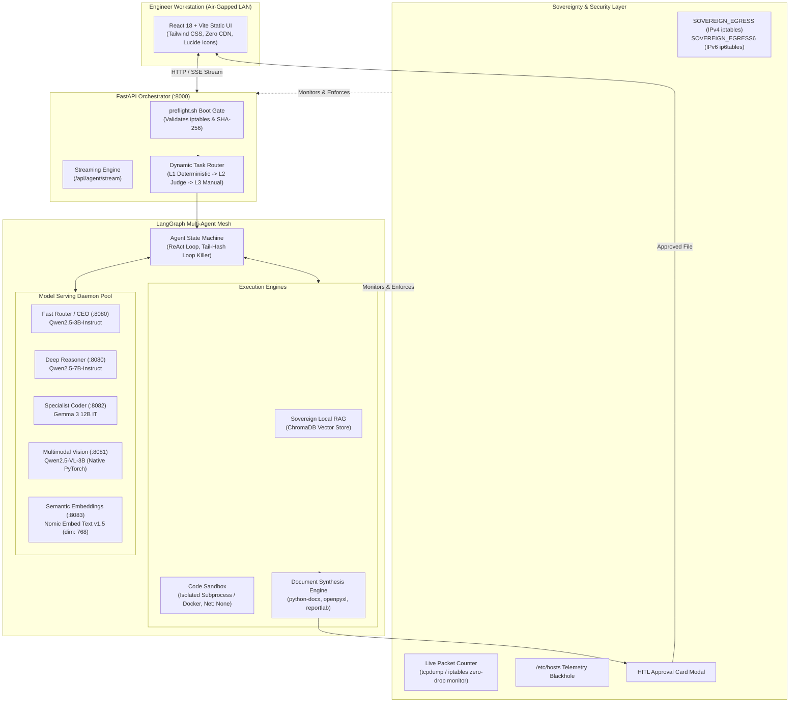

# Swara.ai (Project Kavach) — System Architecture

---

## 1. Architectural Principles

1. **Absolute Data Sovereignty**: Zero external API dependencies, zero telemetry, zero data egress.
2. **Deterministic Guardrails**: Multi-agent loops bounded by loop-killers, density gates, and sandboxed execution.
3. **Multi-Model Cooperation**: Distinct specialized models for Routing, Deep Reasoning, Code Generation, Vision OCR, and Semantic Retrieval.
4. **Enterprise Artifacts Over Chat**: Focus on generating high-fidelity, auditable engineering files (`.docx`, `.xlsx`, `.pdf`, `.pptx`) conforming to corporate templates.
5. **Human-In-The-Loop (HITL)**: Mandatory engineer verification and sign-off for critical analytical actions and file generation.

---

## 2. High-Level Architecture Diagram



---

## 3. Core Component Breakdown

### 3.1 Frontend Web UI (`/frontend`)
* **Technology Stack**: React 18, TypeScript, Vite, Tailwind CSS, Lucide React icons.
* **Air-Gap Compliance**: 100% self-contained static build outputted to `/dist`. Zero external CDNs, zero web fonts from Google Fonts, zero tracking scripts.
* **Interactive Capabilities**:
  * Real-time Server-Sent Events (SSE) streaming with visual execution timeline.
  * Collapsible reasoning accordions and live tool execution cards.
  * Document viewer and artifact version history.
  * In-browser Human-In-The-Loop (HITL) approval cards for reviewing code and draft documents.
  * Sovereignty & hardware status modals showing live GPU VRAM and packet egress statistics.

### 3.2 FastAPI Orchestrator Gateway (`/src/main.py`)
* Serves as the central API gateway and session coordinator.
* Manages document uploads, P&ID image ingestions, and vector database indexing.
* Implements SSE streaming endpoints (`/api/agent/stream`) delivering granular stage updates (`PLANNING`, `TOOL_CALL`, `OBSERVATION`, `HITL_REQUIRED`, `SYNTHESIS`, `DONE`).
* Exposes system telemetry, model health checks, and hardware utilization metrics.

### 3.3 Dynamic 3-Tier Task Router (`/src/router.py`)
Directs incoming queries and files to the appropriate model and execution path:
1. **L1: Deterministic Rules**:
   * Evaluates MIME types, file extensions, regex pattern matching, and file size thresholds.
   * Directs P&ID scans/images immediately to the Multimodal Vision engine.
   * Directs calculation prompts (`calculate`, `simulate`, `benchmark`) directly to the Coder.
2. **L2: Constrained LLM Judge**:
   * For ambiguous queries, invokes the Fast Brain with constrained JSON output grammar to categorize user intent (`GENERAL_ANALYSIS`, `CORROSION_AUDIT`, `P_AND_ID_INSPECTION`, `CODE_SIMULATION`).
3. **L3: Manual User Override**:
   * Enables engineers to explicitly pin specific models (e.g., forcing Gemma 3 12B IT or Deep Reasoner) from the UI settings.

### 3.4 LangGraph Agentic Workflow (`/src/graph.py`)
Orchestrates autonomous multi-step reasoning using a ReAct (Reason + Act) loop:
* **Plan Formulation**: Breaks complex refinery analysis into structured sub-tasks.
* **Tool Invocation**:
  * `rag_search`: Queries local ChromaDB for SOP rules and metallurgy standards.
  * `vision_inspect`: Calls `Qwen2.5-VL` to detect equipment tags and line connectivity.
  * `code_sandbox`: Calls `Gemma 3 12B IT` to write Python scripts for numerical equations and matplotlib charts.
* **Loop-Killer & Density Guards**:
  * Hashes observation outputs to terminate repetitive loops if an agent repeats actions.
  * Density gate filters out malformed or low-information model outputs before synthesis.
* **Human-In-The-Loop (HITL)**:
  * Suspends execution graph before executing file generation or critical scripts, prompting the engineer for confirmation.

### 3.5 Multimodal Vision Engine (`/src/vision_server.py`)
* Powered by **`Qwen2.5-VL-3B-Instruct`** running native PyTorch CUDA acceleration with FlashAttention / SDPA.
* Specifically optimized for:
  * High-resolution P&ID schematic scanning.
  * Recognition of valve symbols (gate, globe, check, ball), pump casings, heat exchangers, and distillation columns.
  * Optical Character Recognition (OCR) of line designations (e.g., `10"-HC-2004-A1A`).
  * Extraction of structured bounding boxes and equipment tags into JSON formats.

### 3.6 Sovereign Local RAG (`/src/ingest.py`)
* Embeddings generated locally by **`nomic-embed-text-v1.5`** (8192 token context window, 768-dimensional vectors).
* Vector storage powered by local **ChromaDB** instances (`/chroma_db`) with telemetry strictly opted out.
* Implements precise citation mapping linking retrieved paragraphs directly to document sources (`[SOP-REF §X.X p.Y]`).

### 3.7 Hardened Code Sandbox (`/src/sandbox_runner.py`)
* Executes calculation scripts and data visualization routines in an isolated environment:
  * Network namespace completely unshared (`network_mode="none"`).
  * Enforces CPU execution time quotas (max 15s) and memory caps (2 GB RAM).
  * Read-only filesystem mounts with isolated temporary scratch workspaces.

### 3.8 Document Synthesis Engine (`/src/exporter.py`)
* Compiles multi-page deliverables directly from verified calculation data and model drafts:
  * **Microsoft Word (`.docx`)**: Styled using corporate templates (`assets/mrpl_template.dotx`) with headers, footers, callout boxes, and metadata tables.
  * **Microsoft Excel (`.xlsx`)**: Populated with raw data, formulas, and formatted audit sheets using `openpyxl`.
  * **PDF (`.pdf`)**: Rendered via `reportlab` with exact margins, pagination, and vector figures.
  * **PowerPoint (`.pptx`)**: Generates slide decks for plant manager briefings using `python-pptx`.

---

## 4. Dual-Topology Architecture: Development vs. Production

```
┌────────────────────────────────────────────────────────────────────────┐
│               SWARA.AI DUAL-TOPOLOGY ARCHITECTURE                     │
├──────────────────────────────────┬─────────────────────────────────────┤
│   DEVELOPMENT & TESTING TESTBED  │   FINAL PRODUCTION DEPLOYMENT       │
│   (Distributed Kaggle Dual-Cloud)│   (Sovereign On-Premise Air-Gap)    │
├──────────────────────────────────┼─────────────────────────────────────┤
│ • Hardware: 2x Kaggle Accounts   │ • Hardware: 1x On-Premise Station   │
│   4x Tesla T4 GPUs (64 GB VRAM)  │   (NVIDIA RTX 3090 / 4090 24GB VRAM)│
│ • Topology: Distributed Cluster  │ • Topology: Unified Local Host      │
│   - Account 1: Reasoner + Vision │   - Single GPU VRAM Budgeting:      │
│   - Account 2: CEO + Coder + Emb │     • Brain 7B: ~7.5 GB             │
│ • Transport: Cloudflare Tunnels  │     • Vision 3B: ~2.0 GB            │
│ • Purpose: Multi-model stress    │     • Coder 3B/7B: ~2.9 GB          │
│   testing without enterprise GPU │     • Embeddings: ~0.5 GB           │
│   budget constraints             │ • Transport: Local Unix / IPC Sockets│
│ • Security: Ephemeral SSL tunnel │ • Security: 100% Air-Gapped Physical│
│   with authenticated proxy test  │   Isolation; Zero Cloud Egress      │
└──────────────────────────────────┴─────────────────────────────────────┘
```

### 4.1 Development Testbed Rationale
High-parameter models (such as Google Gemma 3 12B IT, Qwen2.5-7B, and Qwen2.5-VL) require substantial GPU memory during concurrent evaluation. As student developers, utilizing dual Kaggle instances provides **64 GB of aggregate VRAM** for thorough validation without incurring thousands of dollars in cloud computing costs.

### 4.2 Production Air-Gap Commitment
In production at an MRPL refinery facility, the entire cluster compiles into a **single-node or on-premise rack server** running completely offline on internal refinery power and network infrastructure. No external network requests are permitted or required.
